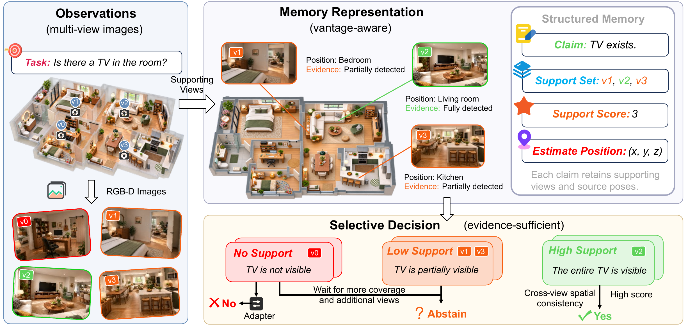
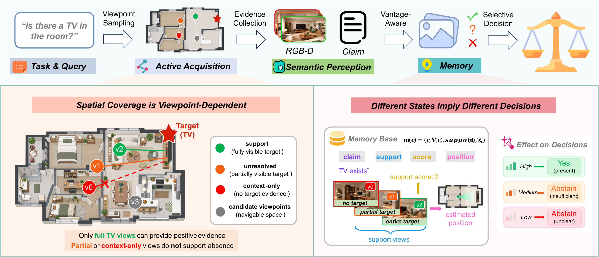

# SafeVantage

### Vantage-Aware Memory for Reliable Embodied Decisions

[Project page](https://safevantage.github.io/) · [MIT-licensed code](LICENSE)

Sean Hardesty Lewis, Zuyi Guo, Benwang Chen, Zirui Li, Hongyi Lin, Heye Huang

SafeVantage builds a memory of the views acquired while exploring a scene and the evidence each view provides for a semantic claim. It uses this memory to choose where to look next and to decide whether the evidence supports a **Yes**, **No**, or **Abstain** response.



## Results

The primary ProcTHOR evaluation covers 232 held-out houses and compares SafeVantage with validation-selected, equal-budget baselines. At eight actions, macro-F1 increases from 0.4845 to 0.6044; at twelve actions, it increases from 0.5855 to 0.6559. The reported SafeVantage results also have lower selective risk and travel than the selected baselines.

The repository includes the aggregate summaries and the scene-paired statistics used to calculate the primary comparisons and uncertainty intervals.



## Method

The ProcTHOR evaluator separates policy inputs from scene-level visibility labels. It simulates acquired observations, stores their viewpoint and evidence, and evaluates both view selection and the resulting selective decision. The primary run uses the controlled sensor and fixed action budgets. The policy implementation is in [`src/safevantage/procthor/evaluate_procthor.py`](src/safevantage/procthor/evaluate_procthor.py); the observation-outcome model is fitted by [`fit_observation_outcome.py`](src/safevantage/procthor/fit_observation_outcome.py).

## Repository layout

```text
assets/       Project figures
configs/      Experiment settings
data/         Dataset access notes
docs/         Methods, results, and reproduction guide
protocols/    Evaluation protocols
results/      Archived aggregate results
scripts/      Preparation and experiment runners
src/          SafeVantage policies and analyses
tests/        Automated tests
```

## Installation

Use Python 3.11 or newer:

```bash
python -m venv .venv
# Activate the environment, then:
python -m pip install -r requirements.txt
```

The experiments use separately obtained simulator and benchmark assets. See [`data/README.md`](data/README.md) for the official sources and access terms.

## Reproduce

The main evaluator reads prepared ProcTHOR scenes. The preparation scripts create a fixed scene manifest, build the category inventory from training scenes, render the scene records, and check their format. The complete steps and input layout are in [`docs/REPRODUCE.md`](docs/REPRODUCE.md).

Set `SCENE_ROOT` to the prepared scene directory and run the primary evaluation:

```bash
SCENE_ROOT=/path/to/prepared/scenes bash scripts/run_native_232.sh
```

This fits the observation-outcome model and decision heads on training data, evaluates the held-out split at 8 and 12 actions, and writes episode outputs and paired scene summaries under `results/generated/native_232/`.

Run the native policy ablations with:

```bash
SCENE_ROOT=/path/to/prepared/scenes bash scripts/run_native_232_ablation.sh
```

The reproduction guide also describes the grouped-vantage, HM3D, ScanNet, and decision-resolution analyses.

## Acknowledgements

The ProcTHOR preparation scripts use MolmoSpaces to retrieve the pinned ProcTHOR scenes and THOR assets. The SafeVantage policies and evaluation methods are implemented in this repository. Additional analyses use HM3D and ScanNet.

## License

Project code and documentation are licensed under the [MIT License](LICENSE). Dataset and simulator assets retain their own access terms and licenses.

## Contributions

Contributions are welcome. Please open an issue to discuss a bug or proposed change; pull requests with focused changes and a clear description are appreciated. For questions about SafeVantage, contact Heye Huang at [heye.huang@kaist.ac.kr](mailto:heye.huang@kaist.ac.kr).
